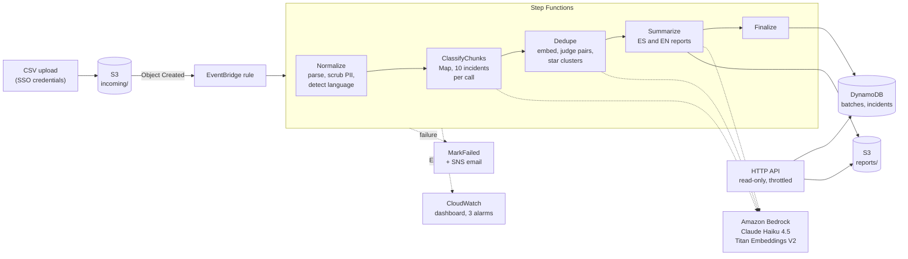

# TriageLite

[](https://github.com/LuisMuz/triage-lite/actions/workflows/ci.yml)

Drop a CSV of messy QA bug reports, in Spanish, English or both, into S3, and about a minute later you get every incident classified, duplicates merged across languages, and a QA triage report in both languages. It runs on AWS serverless, uses Claude Haiku 4.5 on Amazon Bedrock, and costs about USD 0.21 per 100 incidents.

On a frozen holdout set it scores **0.768 severity macro-F1** and 91% duplicate precision at 100% recall. Every number in the report is computed by code, never written by the model.

## Architecture



Seven arm64 Python 3.12 Lambda functions share one code package, each with its own IAM role. Everything is in Terraform under `infra/`. There is no NAT gateway, load balancer, container or database server, so an idle deployment costs almost nothing.

## Results

Measured on `evals/datasets/seed-v1`: 120 bilingual incidents for a fictional e-commerce app, with 22 duplicate groups (9 cross-language) and 9 near-misses. The set is hash-frozen and split by duplicate group into tuning (60) and holdout (60). The labels were generated by Claude and reviewed.

**Classification** (`classify/v3`, Claude Haiku 4.5, 10 incidents per call, 3 repeats pooled, 95% bootstrap CI):

| split | severity macro-F1 | severity acc | component acc | category acc | valid first try | USD / 100 | p95 latency per call |
|---|---|---|---|---|---|---|---|
| tuning | 0.746 [0.651–0.828] | 73.9% | 93.9% | 91.7% | 100% | 0.073 | 5.2 s |
| holdout | 0.768 [0.673–0.849] | 76.1% | 91.7% | 87.8% | 100% | 0.074 | 5.6 s |

Per class on holdout: critical F1 0.90, high 0.79, medium 0.63, low 0.76. Medium is the weakest class: its recall is 0.56.

**Deduplication** (Titan V2 embeddings, cosine ≥ 0.30 and top-5 candidates, then a Claude judge):

| split | arm | precision | recall |
|---|---|---|---|
| holdout | similarity only | 26.9% [13.3–50.0] | 100% |
| holdout | similarity + judge | 91.3% [73.9–100] | 100% |

All 21 gold pairs were found, including the 6 that cross languages. 2 of 59 unrelated candidate pairs were merged.

**Report.** The model drafts the report, and code rejects any draft containing a number it didn't get from a placeholder. A rejected draft is retried once, then replaced by a fixed template. On the sample batch (20 runs × 2 languages), template fallbacks dropped from **17/40 to 8/40** (Fisher one-sided p = 0.026) after better retry feedback and a rewritten prompt. A further prompt cut them to 5/40 but missed the bar set before the run, so it was not adopted.

**What didn't work.** Four other classify prompt changes (decision steps, boundary examples, an anchored confidence scale, shorter rationales) showed no significant change in severity macro-F1. Each is in `evals/results/SUMMARY.md` with its paired comparison. Of the other Bedrock models tried with the same prompt, Kimi K2.5 matched Claude on severity at 56% lower cost but lost 5.6 points of category accuracy. Nova Lite, gpt-oss-120b and DeepSeek V3.2 were cheaper still, but each failed the regression gate.

Reproduce with `make eval REPEAT=3` (tuning), `make eval-dedupe` and `make eval-summarize`. Every run writes a JSON and a Markdown report to `evals/results/`.

## Cost

| | USD |
|---|---|
| Classify, per 100 incidents | 0.074 |
| Embeddings + duplicate judge, per 100 incidents | 0.105 |
| Report, per batch (2 languages) | 0.012–0.024 |
| Total, per 100 incidents (60-incident batch) | ≈ 0.21 (ceiling 1.00) |
| Sample batch in the cloud (20 incidents, 28 model calls) | 0.048 |
| One uncached CI eval run | ≈ 0.13 |
| Idle deployment, per month | ≈ 0.10 (S3 storage; Lambda, Step Functions, DynamoDB, the HTTP API and CloudWatch stay within the free tier) |

Every model call records its tokens and cost. Each batch stores its total cost, and the dashboard plots it. An account-wide budget emails at 85% and 100% of USD 30/month, and when the forecast passes 100%. An alarm fires when model calls cost USD 0.50 or more in 24 hours.

## Run it yourself

You need an AWS account you can sign in to with IAM Identity Center, Terraform ≥ 1.10, Python 3.12 and [uv](https://docs.astral.sh/uv/). Everything runs in `us-east-1`. The first call to an Anthropic model in a new account may ask for Anthropic's short use-case form in the Bedrock console. A deploy, one sample run and a destroy on the same day cost well under USD 1.

1. **Bootstrap** the Terraform state bucket, the cost budget and the CI roles. Bucket names are global, so pick your own. Set `github_repository` to your fork's OIDC subject prefix without `repo:`, from `gh api repos/<owner>/<repo>/actions/oidc/customization/sub --jq .sub_claim_prefix`, or the CI roles will trust this repository.
   ```bash
   terraform -chdir=infra/bootstrap init
   terraform -chdir=infra/bootstrap apply \
     -var state_bucket_name=<your-state-bucket> \
     -var budget_alert_email=<you@example.com> \
     -var github_repository=<owner@id/name@id>
   ```
2. **Deploy** the pipeline. `make build` packages the Lambda code and dependencies, and must run before every plan or apply that should pick up code, config or prompt changes.
   ```bash
   make install
   make build
   terraform -chdir=infra/envs/demo init -backend-config="bucket=<your-state-bucket>"
   terraform -chdir=infra/envs/demo apply -var alert_email=<you@example.com>
   ```
   Confirm the SNS subscription email to receive the alarms.
3. **Run it**: upload `data/sample.csv` and read the results, as in [Using the deployed demo](#using-the-deployed-demo). The execution takes about a minute.
4. **Tear down**: `terraform -chdir=infra/envs/demo destroy`. The data bucket is emptied with it. The bootstrap's state bucket has `prevent_destroy`; remove that line before destroying the bootstrap.

## Running locally

The same pipeline runs on your machine without anything deployed. It still calls Bedrock, so you need:

- Python 3.12 and [uv](https://docs.astral.sh/uv/).
- An AWS sign-in through IAM Identity Center for an account that can invoke Claude Haiku 4.5 (the `global.` inference profile) and Titan Text Embeddings V2 in `us-east-1`.

```bash
make install
aws sso login --profile <profile>
export AWS_PROFILE=<profile>
make run
make run CSV=path/to/incidents.csv
uv run triagelite run path/to/incidents.csv --out runs/my-test
```

Run these from the repository root: `config/` and `prompts/` are read from the current directory.

**Input.** A UTF-8 CSV whose header has `external_id`, `title` and `description`. It may also have `steps`, `environment`, `reported_at` and `reporter`. A header with any other column is rejected. A bad row is skipped and listed in `row_errors.jsonl`; the rest of the batch still runs. `data/sample.csv` has 20 incidents.

**Output.** Everything goes to `runs/<batch_id>/`, where the batch id is the file name plus a hash of its content. Running the same file again overwrites that folder.

| File | Contains |
|---|---|
| `report.es.md`, `report.en.md` | The final reports |
| `summary.json` | Totals, model calls, cost, PII redactions, duplicate clusters, and which reports fell back to the template |
| `incidents.jsonl` | Normalized incidents with PII redacted |
| `row_errors.jsonl` | Rejected CSV rows and why |
| `classifications.jsonl` | Category, severity and component per incident, or `needs_manual` with the reason |
| `pairs.jsonl`, `clusters.jsonl` | Candidate duplicate pairs with the judge's verdicts, and the resulting clusters |
| `report_facts.json`, `report_drafts.jsonl` | The numbers the report may use, and the model's drafts before placeholders are filled in |
| `llm_calls.jsonl` | One record per model call: model, prompt version, tokens, cost, latency, attempt, status |
| `vectors.npy`, `vectors.json` | The embeddings used for deduplication |

The sample takes 28 model calls and costs about USD 0.05. Logs are JSON lines on stderr, and incident text is never logged. The command exits with code 1 if the run fails.

**Settings.** These environment variables are optional: `TRIAGELITE_CONFIG_DIR` (default `config`), `TRIAGELITE_PROMPTS_DIR` (default `prompts`), `TRIAGELITE_AWS_REGION` (default `us-east-1`) and `TRIAGELITE_LOG_LEVEL` (default `INFO`). Models, prices, prompt versions and limits live in `config/*.toml`.

**Development.** `make help` lists every target.

| Command | Does | Calls AWS |
|---|---|---|
| `make test` | Unit tests with the coverage gate | No |
| `make lint` | Ruff and mypy `--strict` | No |
| `make check` | Lint and tests, as CI runs them | No |
| `make eval` | Classification eval on the tuning split (`PROMPT=classify/vN`, `REPEAT=n`) | Bedrock; answers are cached |
| `make eval-summarize` | Re-runs only the summary on a local run and counts template fallbacks | Bedrock |
| `make infra-check` | Terraform fmt, validate, tflint and checkov | No |

## Using the deployed demo

**Uploads are not public.** A run starts when a CSV lands in `incoming/` of the data bucket. Only someone with AWS credentials for the account can write there; there is no upload endpoint. Sign in with `aws sso login`, then:

```bash
BUCKET=$(terraform -chdir=infra/envs/demo output -raw data_bucket_name)
aws s3 cp data/sample.csv "s3://$BUCKET/incoming/sample.csv"
```

Results come from a read-only HTTP API with no authentication, 10 requests per second (burst 20).

```bash
API=$(terraform -chdir=infra/envs/demo output -raw api_url)
curl "${API}batches"
curl "${API}batches/<batch_id>"
curl "${API}batches/<batch_id>/incidents?needs_manual=true"
curl "${API}batches/<batch_id>/report?lang=es"
```

| Route | Returns |
|---|---|
| `GET /batches` | The 20 latest batches, newest first |
| `GET /batches/{id}` | Status, totals, cost and report keys; a failed batch has its reason |
| `GET /batches/{id}/incidents` | Incidents with their classification and cluster; `needs_manual=true` or `false` filters them |
| `GET /batches/{id}/report?lang=es\|en` | The Markdown report, inline |

Every error has the same shape: `{"error": {"code": "not_found", "message": "..."}}`. The codes are `bad_request` (400), `not_found` (404, including a report that isn't ready yet) and `internal` (500).

**Monitoring.** A CloudWatch dashboard shows cost per batch, tokens by stage, validation errors, runs and function errors:

```bash
terraform -chdir=infra/envs/demo output -raw dashboard_url
```

Three alarms email the address in `alert_email`: a run failed or timed out, functions raised 3 or more errors in 5 minutes, and model calls cost USD 0.50 or more in 24 hours. Details are in `infra/modules/observability/README.md`.

## Continuous integration

GitHub Actions authenticates to AWS with OIDC. The roles are defined in `infra/bootstrap/ci.tf`.

| Workflow | Runs on | Does | AWS role |
|---|---|---|---|
| `ci.yml` | Every PR and push to `main` | `uv sync --locked`, ruff, mypy `--strict`, pytest with an 85% coverage gate on `domain`, `llm` and `pipeline` | None |
| `plan.yml` | PRs that change infra, code, config or prompts | `make build`, fmt, validate, tflint, checkov, then `terraform plan` for `infra/envs/demo` in the job summary | `triagelite-plan`: read-only, with object, item, log and execution reads denied; plans run with `-lock=false`, so it never writes |
| `eval.yml` | PRs that change prompts, config, `src/triagelite` or `evals`; pushes to `main`; twice a week | Classifies the tuning split 3 times with the configured prompt and compares it with `main`'s latest result (paired bootstrap). Fails on a significant drop in severity macro-F1, a drop of 5 points or more, or a cost increase above 15% | `triagelite-eval`: only `bedrock:InvokeModel` on the configured Claude profiles |

Model responses are cached between runs (`evals/cache`, keyed by prompt, model, taxonomy, input and a hash of the package code), so re-running an unchanged commit is free and a full run costs about USD 0.13.

`terraform apply` is never run from CI.
